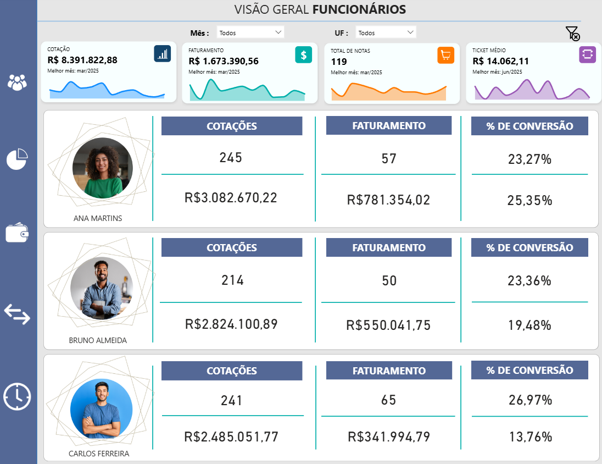
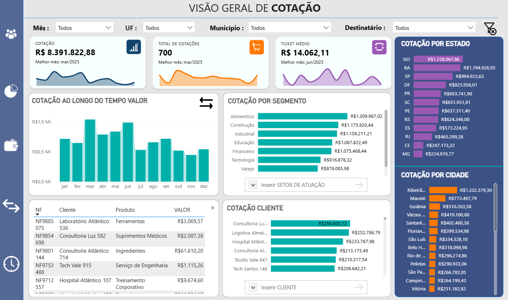
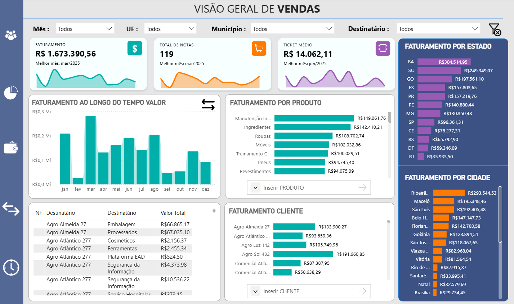
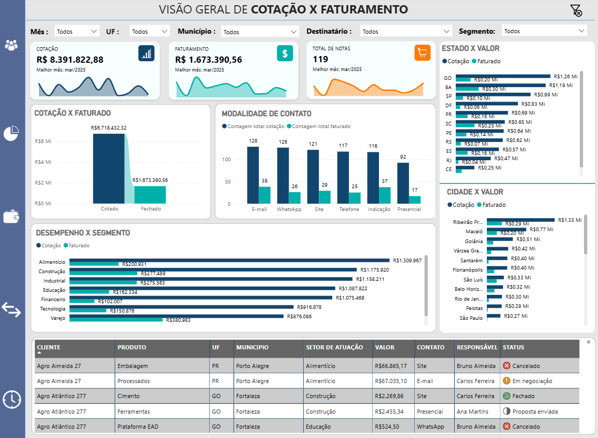
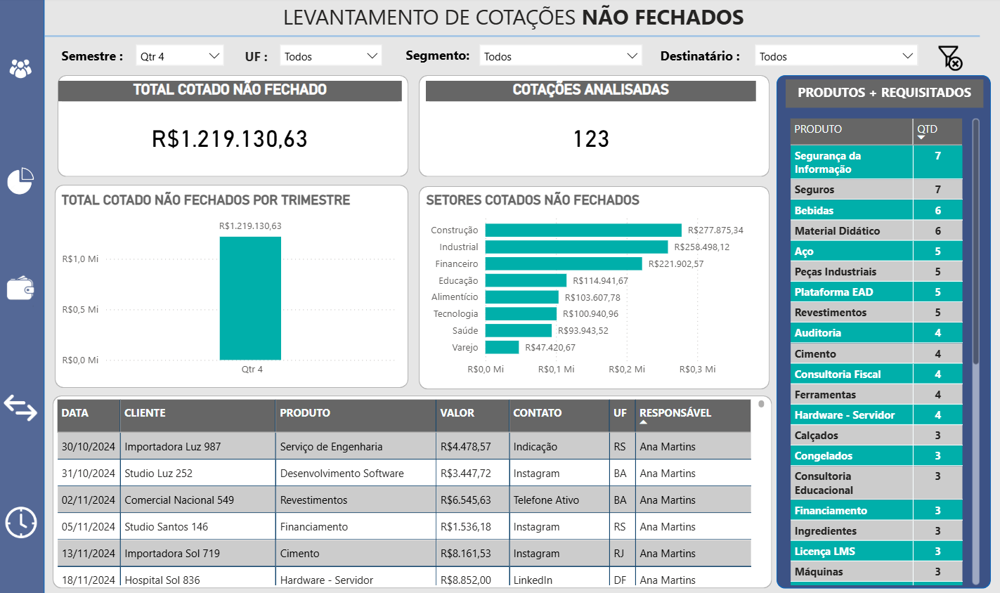

# 📊 Relatório de Vendas 2025 | Power BI + Excel

Dashboard comercial em Power BI que acompanha **cotações, faturamento e conversão** de uma operação B2B, do pedido de cotação até a nota fiscal emitida. O projeto responde a perguntas do dia a dia de um time comercial: quanto foi cotado, quanto virou venda, onde estamos perdendo negócios e quem converte mais.

> ℹ️ Projeto de portfólio feito com **base de dados fictícia**. Nenhuma informação real de clientes ou empresas é utilizada.

---

## 🎯 Problema de negócio

Times comerciais costumam controlar cotações em planilhas e só enxergam o resultado no fim do mês. Este painel centraliza os dados em um único relatório para responder:

- Quanto foi cotado e quanto foi efetivamente faturado?
- Qual a taxa de conversão (em quantidade e em valor)?
- Quais setores, produtos, estados e cidades mais vendem?
- Por que as cotações não fecham e quais estão paradas?
- Como cada responsável comercial está performando?

---

## 📈 Principais números da base

| Indicador | Resultado |
|---|---|
| Cotações registradas | **700** |
| Valor total cotado | **R$ 8,39 milhões** |
| Cotações fechadas | **172** (118 notas fiscais) |
| Faturamento | **R$ 1,67 milhão** |
| Ticket médio | **R$ 14.181** |
| Conversão em quantidade | **24,6%** |
| Conversão em valor | **19,9%** |
| Cobertura | 100 clientes · 40 produtos · 8 setores · 12 UFs · 30 municípios |
| Período | Out/2024 a Out/2025 |

**Destaques:** o melhor mês de faturamento foi **março/2025 (R$ 282 mil)** e o setor com maior faturamento foi **Varejo (R$ 381 mil)**, seguido por Construção e Industrial.

---

## 💡 Insights da análise

- **Alimentício cota muito e fatura pouco:** é o segmento com maior valor cotado (R$ 1,31 mi), mas só cerca de **15%** disso virou faturamento (R$ 201 mil). Já o **Varejo converte 43%** em valor (R$ 381 mil de R$ 876 mil).
- **Indicação é o canal que mais converte:** 37 de 116 cotações fecharam (**32%**), contra 18% no atendimento presencial (17 de 92).
- **Quantidade não é valor:** Carlos tem a maior conversão em quantidade (**26,97%**), mas a menor em valor (13,76%), porque fecha negócios menores. Ana lidera o faturamento (**R$ 781 mil**) com 25,35% de conversão em valor.
- **Cotar não é faturar:** Goiás é o estado com mais valor cotado (R$ 1,26 mi), mas a **Bahia lidera o faturamento** (R$ 305 mil).
- **Sazonalidade:** março/2025 foi o melhor mês, e fevereiro é o mais fraco do período.

---

## 🖥️ Páginas do relatório

| Página | O que mostra |
|---|---|
| **Capa** | Navegação lateral e identidade visual do relatório |
| **Desempenho por responsável** | Cotações, faturamento e taxa de conversão (em quantidade e em valor) de cada vendedor |
| **Visão Geral de Cotação** | Valor e quantidade de cotações por mês, segmento, cliente, estado e cidade, com tabela de notas |
| **Visão Geral de Vendas** | Faturamento, total de notas e ticket médio por mês, produto, cliente, estado e cidade |
| **Visão Geral de Cotação x Faturamento** | Comparação entre o cotado e o faturado, por segmento, localidade e modalidade de contato, com status de cada cotação |
| **Levantamento de Cotações Não Fechados** | Cotações em aberto ou perdidas por trimestre e setor, e produtos mais requisitados, para priorizar follow-up |

Todas as páginas possuem filtros (segmentações) por mês, UF, município, cliente e setor.

---

## 🧮 Modelagem e DAX

**Modelo de dados:** uma tabela fato de cotações, uma tabela **Calendar** (366 dias) e uma tabela dedicada de **Medidas**.

**Medidas principais (exemplos):**

```dax
Faturamento_Real =
CALCULATE(
    SUM('CONSOLIDADO DE COTAÇÔES - 2025'[VALOR]),
    'CONSOLIDADO DE COTAÇÔES - 2025'[STATUS] = "Fechado"
)

Ticket_Medio =
DIVIDE(
    [Faturamento_Real],
    DISTINCTCOUNT('CONSOLIDADO DE COTAÇÔES - 2025'[NF]),
    0
)

Faturamento_Anterior =
CALCULATE(
    [Faturamento_Real],
    PARALLELPERIOD('Calendar'[Date], -1, MONTH)
)
```

**Técnicas utilizadas:**
- `CALCULATE`, `DIVIDE`, `DISTINCTCOUNT`, `SUMMARIZE`, `TOPN` e `PARALLELPERIOD` (comparação com o mês anterior)
- Medida de **"melhor mês"** com `TOPN` + `ALLSELECTED`, exibida nos cartões
- **Cartões personalizados em HTML/CSS** gerados por medidas DAX, com ícones, cores e variação percentual (verde ou vermelha) em relação ao mês anterior
- Taxas de conversão por responsável, em quantidade e em valor

---

## 🔧 Etapas do projeto

1. **Base em Excel:** tabela única de cotações com cliente, produto, valor, status, motivo, canal e responsável
2. **Power Query:** importação do Excel, ajuste de tipos de dados e remoção de colunas desnecessárias
3. **Modelagem:** criação da tabela Calendar e da tabela de Medidas
4. **DAX:** indicadores de faturamento, vendas, ticket médio, cotações e conversão
5. **Visualização:** capa e 5 páginas de análise com cartões, gráficos de linha, colunas e barras, tabelas e segmentações
6. **Design:** identidade visual própria, ícones e navegação entre páginas

---

## 🛠️ Tecnologias


---

## 📸 Prints do dashboard

**Capa**


**Desempenho por responsável**



**Visão Geral de Cotação**



**Visão Geral de Vendas**



**Visão Geral de Cotação x Faturamento**



**Levantamento de Cotações Não Fechados**



---

## 📂 Estrutura do repositório

```
📁 Relatorio-de-Vendas-2025
 ┣ 📄 Relatorio_de_Vendas_2025.pbix
 ┣ 📁 dados
 ┃  ┗ 📄 base_cotacoes.xlsx
 ┣ 📁 imagens
 ┗ 📄 README.md
```
---

## 👤 Autor

**Raphael Pinheiro** · Analista de Dados

[](https://www.linkedin.com/in/raphael-pinheiro-b3062724b)
[](mailto:raphaelspinheiro@hotmail.com)
